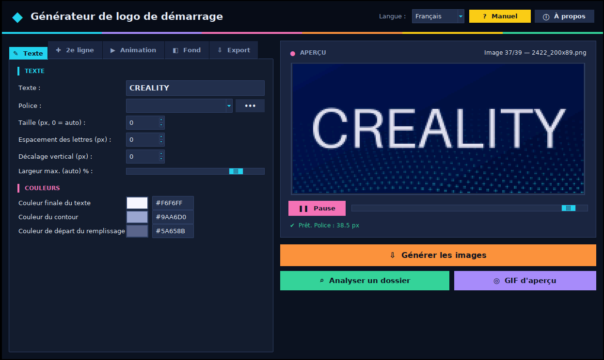

# Boot Logo Generator — 3D Printers

**Générateur de logo de démarrage pour imprimantes 3D**
Create your own animated boot logo for your 3D printer's screen (default settings: Creality Ender-3 V3 SE).


<p align="center">
  
</p>

<p align="center">
  
</p>

[Français](#français) · [English](#english)

---

## Français

### Présentation

Au démarrage, l'écran de nombreuses imprimantes 3D affiche une courte animation faite d'une suite d'images. Cet outil génère une nouvelle séquence avec **votre propre texte**, prête à remplacer les images d'origine.

Il convient à toute imprimante dont l'animation de démarrage est une suite d'images : il suffit de reprendre le nombre d'images, les dimensions et la numérotation d'origine (le bouton **Analyser un dossier** le fait automatiquement). Les réglages par défaut correspondent à l'**Ender-3 V3 SE** : 39 images de 200 × 89 px stockées dans le fichier `tjc.tft` de l'écran.

### Fonctionnalités

- Texte personnalisé sur **une ou deux lignes**, avec police, taille, espacement et couleur réglables pour chaque ligne
- Toutes les polices installées sur l'ordinateur, ou un fichier .ttf / .otf
- **5 styles d'animation** : contour tracé puis remplissage (style Creality d'origine), fondu, lettre par lettre, balayage lumineux, zoom avant
- **4 types de fond** : nappe de points ondulée, couleur unie, dégradé, image (dont le fond Creality d'origine)
- **Analyse d'un dossier existant** : reprend automatiquement le nombre d'images, les dimensions et la numérotation
- Aperçu animé en direct, image par image
- Simulation des couleurs 16 bits (RGB565) de l'écran
- Export des images PNG (`2386_200x89.png` …) et d'un GIF d'aperçu
- Interface moderne, bilingue français / anglais
- Manuel PDF intégré (bouton **Manuel** ou touche **F1**)

### Téléchargement

Téléchargez `Generateur_Logo_Demarrage.exe` dans la page [Releases](../../releases) et lancez-le : aucune installation n'est nécessaire.

> Windows peut afficher « Windows a protégé votre ordinateur » car l'exe n'est pas signé : cliquez sur **Informations complémentaires → Exécuter quand même**.

### Utilisation rapide (exemple : Ender-3 V3 SE)

1. Extrayez les images du logo de démarrage de votre `tjc.tft` (par exemple avec [TJC TFT Tool](https://github.com/naedioba/TJC_TFT_Tools_Ender-3_V3_SE)).
2. Cliquez sur **Analyser un dossier** et choisissez ce dossier ; acceptez d'utiliser la 1re image comme fond.
3. Saisissez votre texte, choisissez la police et le style d'animation.
4. Cliquez sur **Générer les images** et choisissez un dossier vide.
5. Remplacez les images d'origine dans le `tjc.tft`, puis flashez l'écran.

Pour une autre imprimante, la démarche est la même : extrayez les images de démarrage de son firmware d'écran, analysez le dossier, générez, puis réinsérez-les avec l'outil adapté à cet écran.

⚠ Gardez **le même nombre d'images, les mêmes dimensions et les mêmes numéros** que l'original. Conservez toujours une copie du firmware d'écran d'origine.

Manuel complet : [manuels/Manuel_FR.pdf](manuels/Manuel_FR.pdf)

### Lancer depuis le code source

```bash
pip install -r requirements.txt
python generateur_logo_demarrage.py
```

Compiler l'exe Windows :

```bash
pip install pyinstaller
pyinstaller --onefile --windowed --name Generateur_Logo_Demarrage --icon icone.ico --add-data "icone.ico;." --add-data "manuels;manuels" generateur_logo_demarrage.py
```

---

## English

### Overview

At startup, the screen of many 3D printers plays a short animation made of a series of images. This tool generates a new sequence with **your own text**, ready to replace the original images.

It suits any printer whose boot animation is a series of images: you only need to match the original image count, size and numbering (the **Analyze a folder** button does it for you). The default settings match the **Ender-3 V3 SE**: 39 images of 200 × 89 px stored in the screen's `tjc.tft` file.

### Features

- Custom text on **one or two lines**, with font, size, spacing and color set per line
- Any font installed on the computer, or a .ttf / .otf file
- **5 animation styles**: outline drawn then filled (original Creality style), fade in, letter by letter, light sweep, zoom in
- **4 background types**: wavy dot field, solid color, gradient, image (including the original Creality background)
- **Analyze an existing folder**: automatically picks up the image count, size and numbering
- Live animated preview, frame by frame
- Simulation of the screen's 16-bit colors (RGB565)
- Export of PNG images (`2386_200x89.png` …) and a preview GIF
- Modern interface, bilingual French / English
- Built-in PDF manual (**Manual** button or **F1** key)

### Download

Download `Generateur_Logo_Demarrage.exe` from the [Releases](../../releases) page and run it: no installation needed.

> Windows may show “Windows protected your PC” because the exe is not signed: click **More info → Run anyway**.

### Quick start (example: Ender-3 V3 SE)

1. Extract the boot logo images from your `tjc.tft` (for example with [TJC TFT Tool](https://github.com/naedioba/TJC_TFT_Tools_Ender-3_V3_SE)).
2. Click **Analyze a folder** and select that folder; accept using the first image as the background.
3. Type your text, choose the font and the animation style.
4. Click **Generate images** and choose an empty folder.
5. Replace the original images in `tjc.tft`, then flash the screen.

For another printer, the process is the same: extract the boot images from its screen firmware, analyze the folder, generate, then put them back with the tool suited to that screen.

⚠ Keep **the same number of images, the same size and the same numbers** as the original. Always keep a copy of the original screen firmware.

Full manual: [manuels/Manual_EN.pdf](manuels/Manual_EN.pdf)

### Run from source

```bash
pip install -r requirements.txt
python generateur_logo_demarrage.py
```

Build the Windows exe:

```bash
pip install pyinstaller
pyinstaller --onefile --windowed --name Generateur_Logo_Demarrage --icon icone.ico --add-data "icone.ico;." --add-data "manuels;manuels" generateur_logo_demarrage.py
```

---

## Auteur / Author

**Mamadou Bâ Neige** — [neigeba.com](https://neigeba.com) · YouTube [@mamadoubapassioninformatique](https://www.youtube.com/@mamadoubapassioninformatique)

## Licence / License

GNU General Public License v3.0 — voir / see [LICENSE](LICENSE).

*Creality, Ender and other printer names are trademarks of their respective owners. This project is not affiliated with any printer manufacturer.*
